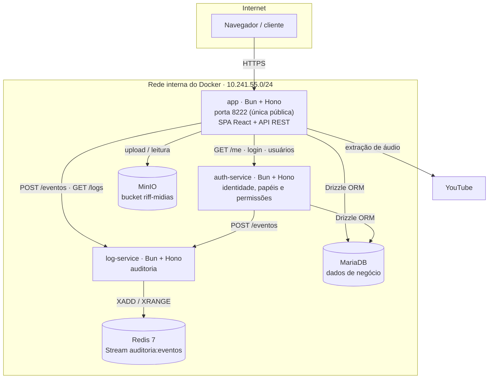
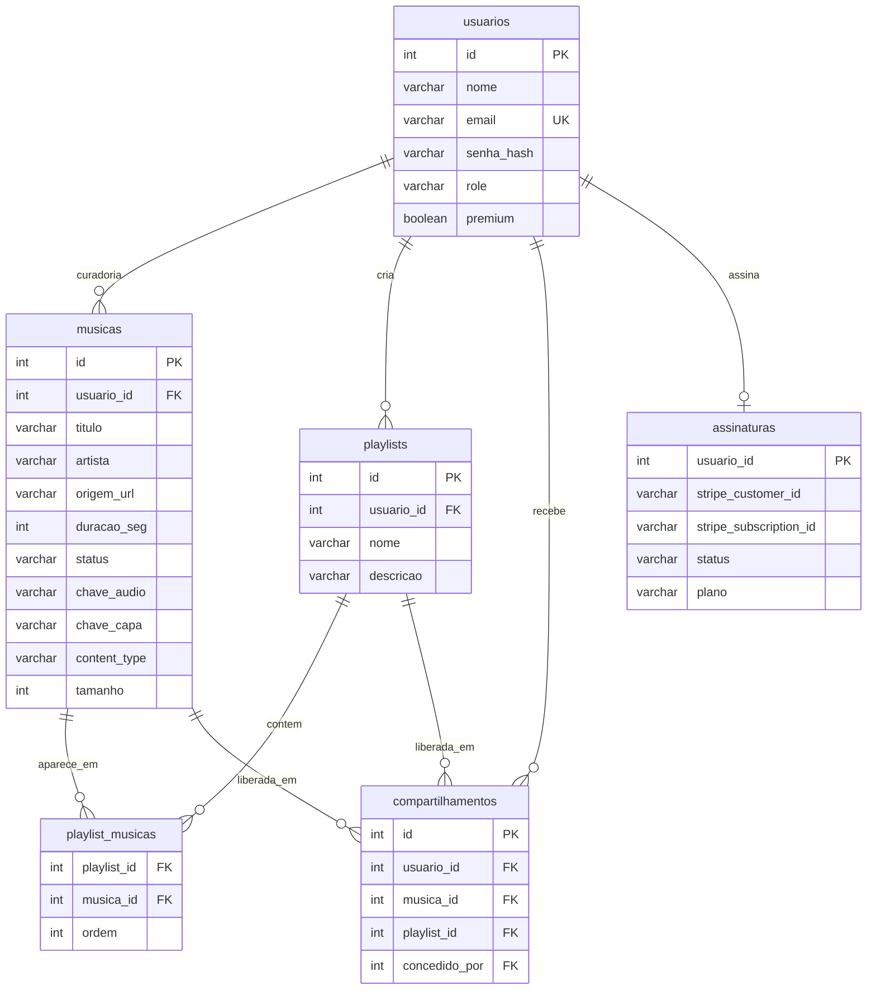

# Riff

**Cole o link do YouTube. A sua música fica com você.**

Riff é um SaaS de biblioteca de música: você cola a URL de um vídeo, o sistema
processa o áudio no servidor, guarda o resultado no
**MinIO** e organiza tudo em **playlists** com papéis de negócio reais
(`admin`, `curador`, `ouvinte`), isolamento por usuário, auditoria e um plano
comercial gratuito/Pro.

> 🔗 **App no ar:** https://mateus-pereira-isw055.lapps.studio
>
> 🎓 Projeto desenvolvido para a disciplina do professor
> **[siriani](https://github.com/siriani)**.
>
> 📦 Repositório público: https://github.com/mateussantospereira/music-sass

---

## Sumário

- [O problema e a proposta](#o-problema-e-a-proposta)
- [Arquitetura](#arquitetura)
- [Papéis e permissões](#papéis-e-permissões)
- [Modelo de dados](#modelo-de-dados)
- [Isolamento por usuário](#isolamento-por-usuário)
- [Eventos de negócio (auditoria)](#eventos-de-negócio-auditoria)
- [Mídia no MinIO](#mídia-no-minio)
- [Extração de áudio](#extração-de-áudio)
- [Plano gratuito e plano Pro](#plano-gratuito-e-plano-pro-assinatura-recorrente)
- [API](#api)
- [Como rodar](#como-rodar)
- [Migrations e seed](#migrations-e-seed)
- [Contas de demonstração](#contas-de-demonstração)
- [Deploy](#deploy)
- [Estrutura do projeto](#estrutura-do-projeto)
- [Decisões de projeto](#decisões-de-projeto)

---

## O problema e a proposta

Quem cura música para estudo, trabalho ou para um time esbarra nos mesmos
problemas:

- as faixas ficam espalhadas em abas do YouTube "para assistir depois";
- não existe uma biblioteca própria com a faixa em `.m4a` na máquina;
- compartilhar com alguém significa mandar link e torcer;
- ninguém sabe quem adicionou, quem baixou ou quem compartilhou o quê.

O Riff resolve isso com quatro ideias simples:

1. **Um recurso principal claro:** a **música** (`musicas`), criada a partir de
   uma URL do YouTube e enriquecida com título, artista, duração, status de
   extração (`processando`, `pronta`, `erro`), áudio e capa no MinIO.
2. **Papéis de negócio reais:** `admin`, `curador` e `ouvinte`, aplicados no
   servidor — esconder um botão na tela não é segurança.
3. **Compartilhamento explícito:** cada faixa e cada playlist são liberadas para quem o dono escolher
   — música a música ou playlist inteira (`compartilhamentos`).
4. **Auditoria de negócio:** adição, extração concluída/falha, edição,
   remoção, reprodução, compartilhamento e tentativas negadas viram
   eventos no Redis Streams, consultáveis pelo admin.

---

## Arquitetura



Pontos importantes:

- **Um único ponto de entrada público.** Só o container `app` publica porta
  (`8222`). `auth-service`, `log-service`, `redis` e `minio` não têm `ports:`.
- **Identidade separada do negócio.** O `app` não tem `JWT_SECRET`, não lê
  senha e não decide papel: ele pergunta ao `auth-service` (`GET /me`), que
  devolve o perfil e a lista de permissões.
- **Frontend desacoplado.** A SPA (React + Tailwind, estilo shadcn) vive em
  [`web/`](web) e é compilada para estático; o `app` serve a build e a API na
  mesma origem (`/api/*`). Não há segundo ponto de entrada.
- **Auditoria separada do banco transacional.** Log de negócio é escrita
  sequencial e leitura cronológica: Redis Streams, não MariaDB.
- **Um banco, dois donos.** `usuarios`/`reset_tokens` pertencem ao
  `auth-service`; `musicas`, `playlists`, `playlist_musicas`,
  `compartilhamentos` e `assinaturas` pertencem ao `app`.

---

## Papéis e permissões

O mapa de permissões mora em
[`auth-service/src/auth/permissoes.ts`](auth-service/src/auth/permissoes.ts).
O `app` recebe a lista pronta e apenas consulta — não existe uma segunda cópia
da regra no frontend nem nas rotas.

| Permissão | `admin` | `curador` | `ouvinte` |
| --- | :---: | :---: | :---: |
| `ler:musica` | ✅ | ✅ (+ compartilhadas com ele) | ✅ (só compartilhadas com ele) |
| `criar:musica` | ✅ | ✅ | ✅ (próprias) |
| `editar:musica` | ✅ | ✅ (próprias) | ✅ (próprias) |
| `apagar:musica` | ✅ | ✅ (próprias) | ✅ (próprias) |
| `gerenciar:playlist` | ✅ | ✅ (próprias) | ✅ (próprias) |
| `compartilhar:musica` | ✅ | ✅ (suas) | — |
| `listar:usuarios` | ✅ | — | — |
| `alterar:papel` | ✅ | — | — |
| `consultar:logs` | ✅ | — | — |
| `ver:faturamento` | ✅ | — | — |

- Todo cadastro novo nasce como **`curador`**. Virar `ouvinte` ou `admin`
  é uma decisão administrativa (`PATCH /api/usuarios/:id/role`).
- O **ouvinte** é o usuário comum do produto: cole o link, processe o áudio e
  veja **somente a própria biblioteca** (adicionar, ouvir, buscar e remover).
  Ele também enxerga o que compartilharem com ele. Ele **não compartilha**
  com terceiros.
- O servidor responde **403** quando a permissão falta, mesmo que a chamada
  venha direto para a API, sem passar pela interface.

### 403 documentado

```bash
# login como ouvinte
TOKEN=$(curl -s -X POST https://mateus-pereira-isw055.lapps.studio/api/login \
  -H 'Content-Type: application/json' \
  -d '{"email":"ouvinte@riff.app","senha":"Ouvinte@123"}' | jq -r .token)

# tentar consultar a auditoria (só admin tem consultar:logs)
curl -i -H "Authorization: Bearer $TOKEN" \
  "https://mateus-pereira-isw055.lapps.studio/api/logs?limite=1"
# HTTP/2 403
# {"error":"Ação negada: o seu papel (ouvinte) não tem a permissão \"consultar:logs\".", ...}
```

---

## Modelo de dados

Todas as tabelas do domínio são criadas por migrations versionadas em
[`db/`](db). O clone do repositório recria o banco com
`bun run db:migrate && bun run db:seed`.



Arquivos de migration:

| Arquivo | O que faz |
| --- | --- |
| `db/000_limpar_legado.sql` | Remove tabelas do projeto anterior (explícito e separado). |
| `db/001_auth.sql` | Cria/completa `usuarios` e `reset_tokens`; mapeia papéis antigos para `curador`/`ouvinte`. |
| `db/002_dominio.sql` | Cria `musicas`, `playlists`, `playlist_musicas`, `compartilhamentos`, `assinaturas`. |
| `db/004_assinatura.sql` | Tabela `stripe_eventos` (idempotência dos webhooks). |
| `db/003_seed.sql` | Popula as contas de demonstração, músicas demo, playlist e compartilhamentos. |

---

## Isolamento por usuário

A regra não está na tela. Ela está em [`src/routes/musicas.ts`](src/routes/musicas.ts) e [`src/routes/playlists.ts`](src/routes/playlists.ts):

```ts
// Leitura: admin, dono, ou alguém liberou explicitamente para você.
async function podeLer(musica, usuarioId, role) {
  if (role === "admin" || musica.usuarioId === usuarioId) return true;
  const ids = await idsCompartilhadosCom(usuarioId); // direto ou via playlist
  return ids.includes(musica.id);
}
```

- `admin` vê tudo.
- `curador` vê as próprias faixas + as que compartilharem com ele.
- `ouvinte` vê a própria biblioteca e o que compartilharem com ele.
- Qualquer outro caso: **403**, mesmo com o ID correto na mão. O mesmo ID que
  aparece em `/api/musicas/123` devolve 403 para quem não é dono nem ouvinte
  liberado, e 404 quando o recurso não existe.

O áudio nunca sai sem checagem: `GET /api/musicas/:id/stream` e
`GET /api/musicas/:id/stream` autentica (header `Authorization` ou `?token=`
para a tag `<audio>`), revalida a visibilidade e só então devolve os bytes.

---

## Eventos de negócio (auditoria)

O `app` e o `auth-service` enviam eventos ao `log-service`, que grava no Redis
Stream `auditoria:eventos` com **quem, quando e o quê**:

| Ação | Quando acontece |
| --- | --- |
| `musica_adicionada` | Uma música é criada a partir de uma URL. |
| `musica_pronta` | A extração do áudio terminou e o arquivo está no MinIO. |
| `extracao_falhou` | A extração falhou; `erro_msg` guarda o motivo. |
| `musica_editada` | Título/artista mudam. |
| `musica_removida` | Faixa, capa e relações são apagados. |
| `musica_reproduzida` | Stream da faixa no player. |
| `musica_compartilhada` / `musica_descompartilhada` | Liberação/revogação para um ouvinte. |
| `playlist_criada` / `playlist_editada` / `playlist_removida` | Ciclo de vida da playlist. |
| `playlist_musica_adicionada` / `playlist_musica_removida` | Curadoria das faixas. |
| `playlist_compartilhada` / `playlist_descompartilhada` | Playlist liberada/revogada. |
| `acao_negada` | Qualquer resposta 403 (com permissão exigida e papel). |
| `login` / `login_falhou` / `logout` | Acesso à conta. |
| `alterar_papel` | Admin promove/rebaixa alguém. |
| `assinatura_pro_ativada` / `assinatura_pro_cancelada` | Webhook do Stripe. |

O admin consulta os últimos eventos em **Painel → Auditoria** ou por
`GET /api/logs?limite=100`.

---

## Mídia no MinIO

- Bucket: `riff-midias` (criado automaticamente no boot).
- Chave do áudio: `musicas/<usuario_id>/<musica_id>/<timestamp>-audio.m4a`.
- Chave da capa: `capas/<usuario_id>/<musica_id>/<timestamp>-capa.<ext>`.
- O MariaDB guarda **somente as chaves** em `musicas`; o binário não entra no banco.
- O navegador nunca fala com o MinIO: a leitura passa por rotas
  autenticadas que conferem dono ou compartilhamento antes de devolver os bytes.

### Cache de áudio no navegador

Como no YouTube, depois de reproduzida a faixa fica em **cache no navegador do
cliente** (Cache Storage, chave `riff-audio-v1`, servindo os bytes sem nova
leitura autenticada do servidor):

- **Validade de 7 dias** desde a reprodução;
- **80 MB no total**, descartando as mais antigas primeiro (LRU);
- o cache é **limpo automaticamente** ao abrir o app e sempre que estoura o
  limite;
- ou manualmente pelo botão **“Limpar cache de áudio”** na barra superior.

Nada é salvo como arquivo na máquina: o áudio vive no cache do navegador e
sai de lá sozinho. O servidor continua autenticando e autorizando o stream —
o cache apenas evita repetir a leitura nas próximas vezes.

---

## Extração de áudio

1. `POST /api/musicas { url }` valida a URL (somente YouTube:
   `watch`, `youtu.be`, `shorts`), cria o registro com `status = 'processando'`
   e responde `201`.
2. Em background, o worker obtém os metadados e o áudio (m4a) no servidor e
   baixa a capa quando houver.
3. O áudio/capa sobem para o MinIO; o registro vira `status = 'pronta'` com
   `chave_audio`, `chave_capa`, `duracao_seg` e `tamanho`.
4. Se algo falhar, o registro vira `status = 'erro'` com `erro_msg`, e a tela
   de detalhe oferece **Reprocessar** (`POST /api/musicas/:id/reprocessar`).

O plano gratuito inclui até **10 músicas** (`LIMITE_MUSICAS_GRATIS`); no Pro a
extração é ilimitada.

---

## Plano gratuito e plano Pro (assinatura recorrente)

Modelo de receita do produto:

| Plano | Preço | Limite |
| --- | --- | --- |
| Gratuito | R$ 0,00 | 10 músicas (`LIMITE_MUSICAS_GRATIS`) |
| Pro | R$ 29,00/mês | sem limite |

**Modo de teste, sempre.** Cobrança real não existe neste projeto. O Stripe
roda em test mode: chaves começam com `sk_test_`/`whsec_` e o cartão da
demonstração é `4242 4242 4242 4242` (qualquer validade futura, qualquer CVC).
Nenhum dado de cartão passa pelo backend — o checkout é a página hospedada do
Stripe.

### Ciclo de vida da assinatura

O plano do usuário é um **estado mantido pelos webhooks do Stripe**, não pelo
redirect do checkout e não pela tela. Fluxo:

```text
Free → Checkout (mode=subscription) → Stripe cobra todo mês
     → webhook assinado e validado  → cria/atualiza `assinaturas`
     → auth-service marca usuarios.premium → limite some da API
     → Portal do cliente: troca de plano / cancelamento
     → customer.subscription.deleted → volta para o Free
```

O `app` abre caminhos (checkout e portal). Quem muda o plano no banco é sempre
o webhook, que chega por fora a qualquer hora — e pode chegar mais de uma vez,
por isso o `app` grava o `id` de cada evento em `stripe_eventos` e não
processa o mesmo evento duas vezes (sem efeito duplicado em reenvios).

### Eventos tratados e o que mudam no banco

| Evento | Quando chega | O que o app faz |
| --- | --- | --- |
| `checkout.session.completed` | Checkout da assinatura concluído | Grava `stripe_customer_id` e `stripe_subscription_id` em `assinaturas`, marca `status = ativa`, plano Pro e `usuarios.premium = TRUE` (via auth-service) |
| `customer.subscription.updated` | Troca de plano, renovação, mudança de status | Atualiza `assinaturas.status` (active, past_due, canceled…); mantém ou retira o Pro conforme `status` (`active`/`trialing` ⇒ Pro) |
| `customer.subscription.deleted` | Assinatura terminada | `status = cancelada` e `usuarios.premium = FALSE` — a conta volta para o Free |
| `invoice.payment_failed` | A cobrança da renovação falhou | `status = inadimplente` e `usuarios.premium = FALSE`; evento `assinatura_pro_inadimplente` na auditoria com quem, quando e o motivo. O Pro não continua de graça |

Limites valem **na API**: a décima primeira música do Free responde `402` com
uma mensagem clara — o limite do plano vale no servidor, não na tela.

### Configurar (modo de teste)

No painel do Stripe (test mode):

1. **Products** → cadastre **Riff Pro** com preço recorrente mensal de R$ 29,00.
   Copie o `price_…` (vai para `STRIPE_PRICE_ID`). O Free pode ter preço R$ 0,00.
2. **Developers → API keys** → copie a *Secret key* (vai para `STRIPE_SECRET_KEY`).
3. **Developers → Webhooks** → adicione
   `https://mateus-pereira-isw055.lapps.studio/api/plano/webhook`
   com os eventos `checkout.session.completed`, `customer.subscription.updated`,
   `customer.subscription.deleted` e `invoice.payment_failed`.
   Copie o *Signing secret* (vai para `STRIPE_WEBHOOK_SECRET`).
4. **Settings → Billing → Customer portal** → salve a configuração do portal
   (o link volta para `/painel/plano`).
5. As chaves ficam **somente nas variáveis da stack no Portainer** — nunca no
   repositório. O `.env.example` lista apenas os nomes.

Para testar de ponta a ponta: crie uma conta nova (nasce Free), estoure o
limite do Free (a API recusa), assine o Pro com o cartão de teste, veja o
webhook chegar no painel do Stripe e no log de auditoria — o plano vira Pro e
o limite some. Abra **Gerenciar assinatura** (Billing Portal) e cancele;
quando o webhook do cancelamento chega, a conta volta para o Free.

### Painel de faturamento (admin)

Rota `/painel/faturamento`, exclusiva de quem tem `ver:faturamento` (admin):
quantos usuários estão em cada plano, quantas assinaturas estão ativas /
inadimplentes / canceladas, o **MRR** em modo de teste (assinaturas ativas ×
valor mensal do Price) e os últimos 5 eventos do log de auditoria.

Sem chaves do Stripe configuradas, o checkout responde 503 e o restante do
produto continua funcionando no plano gratuito — inclusive o painel (mostra os
números que vêm do banco, com o Stripe sinalizado como não configurado).

---

## API

Todas as rotas abaixo, exceto login/cadastro/health, exigem
`Authorization: Bearer <token>`.

### Autenticação (proxy para o auth-service)

| Método | Rota | Descrição |
| --- | --- | --- |
| `POST` | `/api/register` | Cadastro (nasce `curador`). |
| `POST` | `/api/login` | Login, devolve JWT. |
| `POST` | `/api/logout` | Registra o logout na auditoria. |
| `GET` | `/api/me` | Perfil + lista de permissões. |
| `POST` | `/api/forgot-password` | Envia link de redefinição. |
| `POST` | `/api/reset-password` | Troca a senha com token. |

### Recurso principal: músicas

| Método | Rota | Permissão | Descrição |
| --- | --- | --- | --- |
| `GET` | `/api/musicas` | `ler:musica` | Lista conforme a visibilidade do papel. |
| `POST` | `/api/musicas` | `criar:musica` | Adiciona por URL (extração assíncrona). |
| `GET` | `/api/musicas/:id` | `ler:musica` | Detalhe + compartilhamentos (dono/admin). |
| `PATCH` | `/api/musicas/:id` | `editar:musica` | Edita título/artista. |
| `DELETE` | `/api/musicas/:id` | `apagar:musica` | Apaga faixa, capa e relações. |
| `POST` | `/api/musicas/:id/reprocessar` | `editar:musica` | Refaz a extração de uma faixa com erro. |
| `GET` | `/api/musicas/:id/stream` | `ler:musica` | Player (header ou `?token=`). |
| `GET` | `/api/musicas/:id/capa` | `ler:musica` | Capa do álbum. |
| `POST` | `/api/musicas/:id/compartilhar` | `compartilhar:musica` | Libera para um ouvinte. |
| `DELETE` | `/api/musicas/:id/compartilhar/:usuarioId` | `compartilhar:musica` | Revoga o acesso. |
| `GET` | `/api/musicas/compartilhaveis` | `compartilhar:musica` | Lista os ouvintes do workspace. |

### Playlists

| Método | Rota | Permissão | Descrição |
| --- | --- | --- | --- |
| `GET` | `/api/playlists` | autenticado | Minhas (admin: todas) + compartilhadas comigo. |
| `POST` | `/api/playlists` | `gerenciar:playlist` | Cria playlist. |
| `GET` | `/api/playlists/:id` | autenticado* | Detalhe + faixas (*dono, admin ou liberada). |
| `PATCH` | `/api/playlists/:id` | `gerenciar:playlist` | Renomeia/edita. |
| `DELETE` | `/api/playlists/:id` | `gerenciar:playlist` | Apaga a playlist. |
| `POST` | `/api/playlists/:id/musicas` | `gerenciar:playlist` | Adiciona faixa. |
| `DELETE` | `/api/playlists/:id/musicas/:musicaId` | `gerenciar:playlist` | Remove faixa. |
| `POST` | `/api/playlists/:id/compartilhar` | `compartilhar:musica` | Libera para um ouvinte. |
| `DELETE` | `/api/playlists/:id/compartilhar/:usuarioId` | `compartilhar:musica` | Revoga o acesso. |

### Usuários, logs e plano

| Método | Rota | Permissão |
| --- | --- | --- |
| `GET` | `/api/usuarios` | `listar:usuarios` |
| `PATCH` | `/api/usuarios/:id/role` | `alterar:papel` |
| `GET` | `/api/logs?limite=N` | `consultar:logs` |
| `GET` | `/api/plano/status` | autenticado |
| `POST` | `/api/plano/checkout` | autenticado |
| `POST` | `/api/plano/portal` | autenticado (dono da assinatura) |
| `POST` | `/api/plano/webhook` | assinatura do Stripe |
| `GET` | `/api/plano/resumo` | `ver:faturamento` (admin) |
| `GET` | `/api/health` | público |

---

## Como rodar

Pré-requisitos: **Bun 1.2+** e acesso ao MariaDB.

```bash
# 1. dependências
bun install
(cd auth-service && bun install)
(cd log-service && bun install)

# 2. banco (variáveis DB_* do seu ambiente)
export DB_HOST=... DB_PORT=3306 DB_USER=... DB_PASSWORD=... DB_NAME=...
bun run db:migrate
bun run db:seed

# 3. frontend (uma vez)
(cd web && bun install && bun run build)

# 4. serviços localmente (três terminais)
cd auth-service && APP_PUBLIC_URL=http://localhost:8222 JWT_SECRET=dev \
  DB_HOST=... DB_USER=... DB_PASSWORD=... DB_NAME=... bun run dev
cd log-service && REDIS_URL=redis://localhost:6379 bun run dev
bun run dev   # app em http://localhost:8222
```

Para a extração funcionar, a imagem Docker do app já instala os utilitários
necessários. Sem eles, a música fica com
`status = 'erro'` e a tela oferece reprocessar.

Com Docker:

```bash
cp .env.example .env   # preencha os segredos
docker compose up -d --build
docker compose ps
```

---

## Migrations e seed

```bash
# aplica db/000, db/001 e db/002 em ordem (idempotente)
bun run db:migrate

# popula contas, músicas demo, playlist e compartilhamentos
bun run db:seed
```

- `db:migrate` executa `db/*.sql` em ordem e ignora "já existia".
- `db:seed` executa `db/003_seed.sql` (**e envia os áudios demo ao MinIO**,
  chaves `demo/*.wav`, quando o seed enxerga o MinIO — ex.: dentro da rede
  Docker); pode rodar de novo sem duplicar dados.
- Para recriar do zero em um banco vazio, basta rodar os dois comandos.
- O histórico do projeto anterior continua no repositório
  [`filmes-tom-hanks`](https://github.com/mateussantospereira/filmes-tom-hanks),
  intocado (P1). O `000_limpar_legado.sql` só remove as tabelas antigas do
  banco compartilhado.

---

## Contas de demonstração

| Papel | E-mail | Senha | O que demonstra |
| --- | --- | --- | --- |
| `admin` | `admin@riff.app` | `Admin@123` | Vê tudo, gerencia usuários e auditoria, plano Pro. |
| `curador` | `curador@riff.app` | `Curador@123` | Cria músicas, playlists e compartilhamentos. |
| `ouvinte` | `ouvinte@riff.app` | `Ouvinte@123` | Usuário comum: cola o link, processa e vê só a própria biblioteca. |

O seed também cria:

- 2 músicas demo do `curador` (arquivos em `seed-audio/`, enviados ao MinIO como `demo/*.wav`);
- 1 música demo do `admin` (o `curador` recebe 403 ao abrir pelo ID);
- 1 música demo do `ouvinte` (a própria biblioteca dele);
- a playlist **"Estudo e Concentração"** com 2 faixas;
- compartilhamento da playlist **e** de uma faixa avulsa com o ouvinte.

---

## Deploy

O deploy usa o mesmo stack do Portainer da disciplina (stack **22**), o mesmo
subdomínio e o mesmo modelo de variáveis de ambiente:

- URL: https://mateus-pereira-isw055.lapps.studio
- Porta publicada: `8222` (somente o `app`)
- Rede: `interna` (`10.241.55.0/24`)
- Limite de memória: `1g` por container
- Volume: `minio-data`
- Stack: `filmel-tom-hanks` (ID 22), agora apontando para este repositório

Procedimento:

1. Build das imagens a partir deste repositório (ex.: via API do Docker do Portainer).
2. No Portainer, stack 22 → **Editor**; troque `image: metasass-app:latest` por
   `image: riff-app:latest` (e `riff-auth`, `riff-log`), ajuste
   `MINIO_BUCKET=riff-midias` e remova variáveis do domínio anterior
   (`META_*`).
3. **Update the stack** (recria os containers).
4. Rode as migrations pelo console do container `app`:
   ```bash
   bun run db:migrate && bun run db:seed
   ```
5. Confira a stack: `app`, `auth-service`, `log-service` e `redis` devem ficar
   `healthy`.

O deploy anterior não é apagado: o repositório antigo continua público e o
histórico Git preserva o código. O que muda é o stack 22 apontar para este
repositório e o banco deixar de ter as tabelas antigas.

---

## Estrutura do projeto

```text
.
├── db/                       # migrations versionadas + seed
│   ├── 000_limpar_legado.sql
│   ├── 001_auth.sql
│   ├── 002_dominio.sql
│   └── 003_seed.sql
├── seed-audio/               # áudios de demonstração (.wav) enviados ao MinIO pelo seed
├── src/
│   ├── index.ts              # app Hono: API + estáticos da SPA + boot do MinIO
│   ├── db/                   # schema Drizzle, migrate e seed
│   ├── middleware/           # autenticação, permissão e auditoria de 403
│   ├── routes/               # musicas, playlists, usuários, logs, plano, auth
│   └── services/             # clientes auth/log/MinIO/Stripe, extração, plano
├── web/                      # SPA React + Tailwind (landing, biblioteca, player, playlists, admin)
├── auth-service/             # identidade, papéis e permissões (porta interna 3000)
├── log-service/              # auditoria em Redis Streams (porta interna 3000)
├── docs/prints/              # evidências visuais da entrega
├── Dockerfile                # app (multi-stage: build web + runtime com utilitários de áudio)
├── docker-compose.yml        # 5 serviços, 1 porta pública
└── .env.example
```

---

## Decisões de projeto

- **React + Tailwind no frontend, Hono no backend.** A SPA (`web/`, estilo
  shadcn) compila para estático e é servida pelo próprio `app` — uma origem,
  zero CORS, nenhum ponto de entrada extra.
- **O frontend não é a autoridade.** Ele esconde botões para melhorar a
  experiência, mas toda ação é revalidada no servidor. O 403 é a resposta
  canônica para "seu papel não permite", e ele também vira evento de auditoria.
- **Isolamento por construção.** `podeLer`/`ehDono` são as únicas portas; não
  existe consulta que "esqueça" o filtro, e o compartilhamento é uma tabela
  explícita, não um booleano solto.
- **Extração assíncrona, não request bloqueante.** A extração pode demorar; a API
  responde `201` na hora e o cliente acompanha o `status` da música.
- **Preço e limite são regras de negócio, não de pagamento.** O Stripe cobra;
  o app decide o que o plano gratuito pode fazer (`LIMITE_MUSICAS_GRATIS`).
- **MinIO é interno.** O binário nunca é servido diretamente ao navegador; a
  rota de leitura confere o dono ou o compartilhamento antes de devolver os bytes.
- **Cache local com limite e expiração.** Igual ao YouTube: a faixa fica em
  cache no navegador por até 7 dias / 80 MB (LRU), é limpa sozinha e pode ser
  apagada pelo botão “Limpar cache de áudio”.
- **Falha de serviço de apoio não derruba o produto.** Se o `auth-service`
  cair, o app responde 503 nas rotas autenticadas e continua servindo a landing.
  Se o MinIO cair, os uploads respondem 503 e o CRUD continua.
- **Papel desconhecido cai para o menor privilégio.** Um valor corrompido em
  `usuarios.role` vira `ouvinte`, nunca `admin`.

---

Feito com Bun, Hono, React, Tailwind, Drizzle, MariaDB, Redis Streams, MinIO,
Docker e Portainer.
