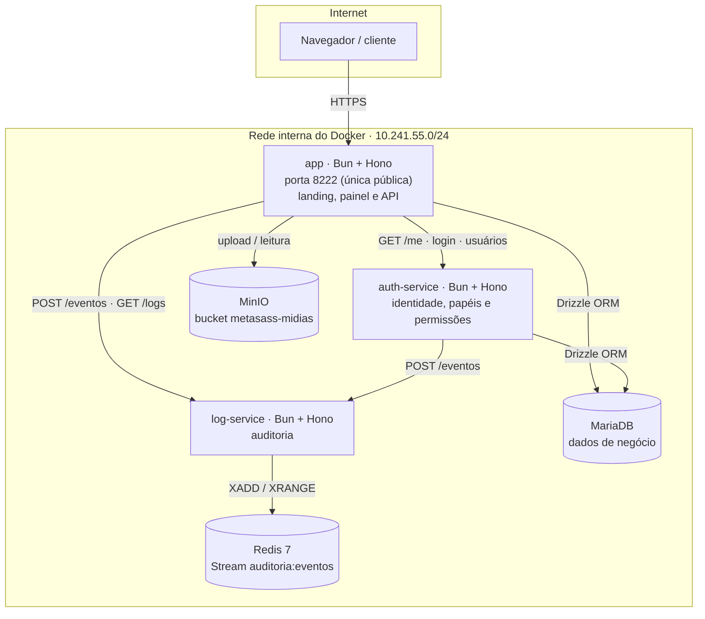
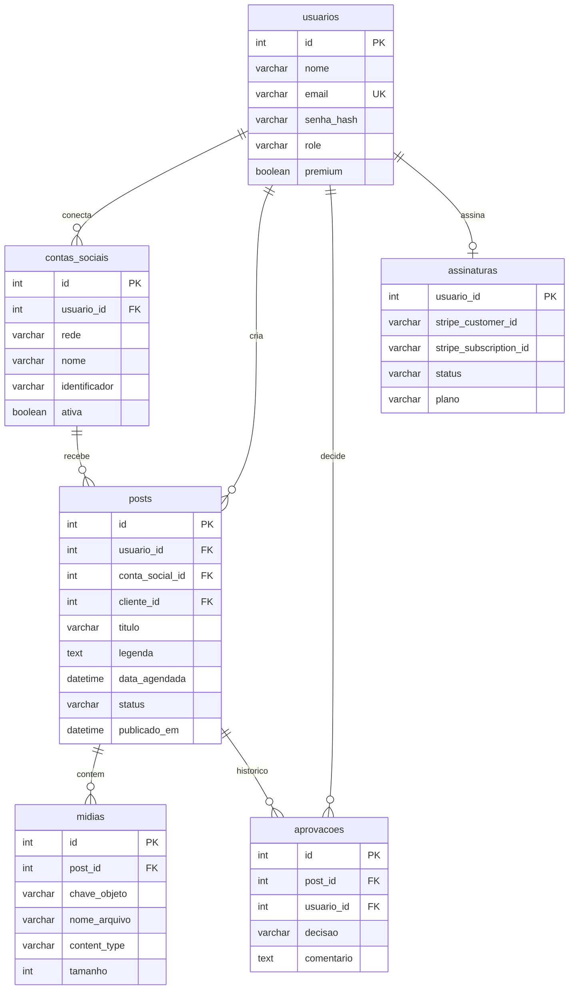

# MetaSass

**Planeje, aprove e publique conteúdo para Instagram e Facebook sem perder o fio.**

MetaSass é um SaaS de calendário editorial para agências e criadores: a equipe
planeja os posts, o cliente aprova (ou pede ajustes) e o conteúdo vai para o ar
com histórico de tudo o que aconteceu. O produto substitui a planilha, o grupo
de WhatsApp e o "print da legenda" por um fluxo único, com papéis bem definidos
e auditoria de cada ação.

> 🔗 **App no ar:** https://mateus-pereira-isw055.lapps.studio
>
> 🎓 Projeto desenvolvido para a disciplina do professor
> **[siriani](https://github.com/siriani)**.
>
> 📦 Repositório público: https://github.com/mateussantospereira/meta-sass

---

## Sumário

- [O problema e a proposta](#o-problema-e-a-proposta)
- [Arquitetura](#arquitetura)
- [Papéis e permissões](#papéis-e-permissões)
- [Modelo de dados](#modelo-de-dados)
- [Isolamento por usuário](#isolamento-por-usuário)
- [Eventos de negócio (auditoria)](#eventos-de-negócio-auditoria)
- [Mídia no MinIO](#mídia-no-minio)
- [Plano gratuito e plano Pro](#plano-gratuito-e-plano-pro)
- [API](#api)
- [Como rodar](#como-rodar)
- [Migrations e seed](#migrations-e-seed)
- [Contas de demonstração](#contas-de-demonstração)
- [Deploy](#deploy)
- [Estrutura do projeto](#estrutura-do-projeto)
- [Decisões de projeto](#decisões-de-projeto)

---

## O problema e a proposta

Uma agência produz conteúdo para vários clientes. Sem uma ferramenta:

- o calendário vive numa planilha que ninguém atualiza;
- a aprovação acontece por WhatsApp, sem registro de quem aprovou o quê;
- quando o cliente pede ajuste, a versão anterior se perde;
- ninguém sabe quem apagou um post ou quem publicou fora do horário.

O MetaSass resolve isso com quatro ideias simples:

1. **Um recurso principal claro:** o **post**, com título, legenda, conta
   social, data agendada e status (`rascunho`, `agendado`, `aprovado`,
   `publicado`, `ajustes`, `cancelado`).
2. **Papéis de negócio reais:** `admin`, `social_media` e `cliente`, aplicados
   no servidor — esconder um botão na tela não é segurança.
3. **Aprovação rastreável:** cada decisão do cliente vira uma linha em
   `aprovacoes`, com autor, data e comentário.
4. **Auditoria de negócio:** criação, edição, aprovação, publicação, remoção e
   tentativas negadas viram eventos no Redis Streams, consultáveis pelo admin.

---

## Arquitetura



Pontos importantes:

- **Um único ponto de entrada público.** Só o container `app` publica porta
  (`8222`). `auth-service`, `log-service`, `redis` e `minio` não têm `ports:`.
- **Identidade separada do negócio.** O `app` não tem `JWT_SECRET`, não lê
  senha e não decide papel: ele pergunta ao `auth-service` (`GET /me`), que
  devolve o perfil e a lista de permissões.
- **Auditoria separada do banco transacional.** Log de negócio é escrita
  sequencial e leitura cronológica: Redis Streams, não MariaDB.
- **Um banco, dois donos.** `usuarios`/`reset_tokens` pertencem ao
  `auth-service`; `contas_sociais`, `posts`, `midias`, `aprovacoes` e
  `assinaturas` pertencem ao `app`.

---

## Papéis e permissões

O mapa de permissões mora em
[`auth-service/src/auth/permissoes.ts`](auth-service/src/auth/permissoes.ts).
O `app` recebe a lista pronta e apenas consulta — não existe uma segunda cópia
da regra no frontend nem nas rotas.

| Permissão | `admin` | `social_media` | `cliente` |
| --- | :---: | :---: | :---: |
| `ler:post` | ✅ | ✅ | ✅ |
| `criar:post` | ✅ | ✅ | — |
| `editar:post` | ✅ | ✅ (próprios) | — |
| `apagar:post` | ✅ | ✅ (próprios) | — |
| `publicar:post` | ✅ | ✅ (próprios) | — |
| `aprovar:post` | ✅ | — | ✅ (atribuídos) |
| `gerenciar:contas` | ✅ | ✅ (próprias) | — |
| `enviar:midia` | ✅ | ✅ (próprios) | — |
| `listar:usuarios` | ✅ | — | — |
| `alterar:papel` | ✅ | — | — |
| `consultar:logs` | ✅ | — | — |

- Todo cadastro novo nasce como **`social_media`**. Virar `cliente` ou `admin`
  é uma decisão administrativa (`PATCH /api/usuarios/:id/role`).
- `cliente` **não** edita nem publica: ele lê e aprova apenas os posts em que
  foi atribuído (`posts.cliente_id`).
- O servidor responde **403** quando a permissão falta, mesmo que a chamada
  venha direto para a API, sem passar pela interface.

### 403 documentado

```bash
# login como cliente
TOKEN=$(curl -s -X POST https://mateus-pereira-isw055.lapps.studio/api/login \
  -H 'Content-Type: application/json' \
  -d '{"email":"cliente@metasass.app","senha":"Cliente@123"}' | jq -r .token)

# tentar criar um post (o papel cliente não tem criar:post)
curl -i -X POST https://mateus-pereira-isw055.lapps.studio/api/posts \
  -H "Authorization: Bearer $TOKEN" \
  -H 'Content-Type: application/json' \
  -d '{"titulo":"x","conta_social_id":1,"data_agendada":"2026-12-01T10:00:00Z"}'
# HTTP/2 403
# {"error":"Ação negada: o seu papel (cliente) não tem a permissão \"criar:post\".", ...}
```

---

## Modelo de dados

Todas as tabelas do domínio são criadas por migrations versionadas em
[`db/`](db). O clone do repositório recria o banco com
`bun run db:migrate && bun run db:seed`.



Arquivos de migration:

| Arquivo | O que faz |
| --- | --- |
| `db/000_limpar_legado.sql` | Remove tabelas do projeto anterior (explícito e separado). |
| `db/001_auth.sql` | Cria/completa `usuarios` e `reset_tokens`. |
| `db/002_dominio.sql` | Cria `contas_sociais`, `posts`, `midias`, `aprovacoes`, `assinaturas`. |
| `db/003_seed.sql` | Popula as contas de demonstração de forma idempotente. |
| `db/004_instagram.sql` | Adiciona campos de conexão OAuth do Instagram e ids/URL da publicação real. |

---

## Isolamento por usuário

A regra não está na tela. Ela está em [`src/routes/posts.ts`](src/routes/posts.ts):

```ts
function podeLer(post, usuarioId, role) {
  return role === "admin" || post.usuarioId === usuarioId || post.clienteId === usuarioId;
}
```

- `admin` vê todos os posts.
- `social_media` vê apenas os próprios.
- `cliente` vê apenas os posts em que foi atribuído.
- Qualquer outro caso: **403**, mesmo com o ID correto na mão.

Abrir `https://mateus-pereira-isw055.lapps.studio/painel?post=<id de outra pessoa>`
mostra a mensagem de acesso negado; a API chamada por trás devolve 403. O mesmo
vale para mídia: os bytes só saem por
`GET /api/posts/:id/midia/:midiaId/arquivo`, depois da checagem de dono.

---

## Eventos de negócio (auditoria)

O `app` e o `auth-service` enviam eventos ao `log-service`, que grava no Redis
Stream `auditoria:eventos` com **quem, quando e o quê**:

| Ação | Quando acontece |
| --- | --- |
| `post_criado` | Um post é criado. |
| `post_editado` | Título, legenda, data, conta ou status mudam. |
| `post_aprovado` | O cliente atribuído aprova. |
| `post_ajustes_solicitados` | O cliente pede ajustes. |
| `post_publicado` | O post é marcado como publicado. |
| `post_removido` | O post e suas mídias são apagados. |
| `midia_enviada` / `midia_removida` | Upload/remoção no MinIO. |
| `acao_negada` | Qualquer resposta 403 (com permissão exigida e papel). |
| `login` / `login_falhou` / `logout` | Acesso à conta. |
| `alterar_papel` | Admin promove/rebaixa alguém. |
| `assinatura_ativada` / `assinatura_cancelada` | Webhook do Stripe. |

O admin consulta os últimos eventos em **Painel → Auditoria** ou por
`GET /api/logs?limite=100`. O evento tem o formato:

```json
{
  "id": "1794596123456-0",
  "timestamp": "2026-11-13T18:15:23.456Z",
  "acao": "post_aprovado",
  "usuario_id": 66,
  "usuario": "Cliente Exemplo",
  "papel": "cliente",
  "recurso": "post:1",
  "detalhe": "Conteúdo aprovado, pode publicar.",
  "ip": "203.0.113.10",
  "origem": "app"
}
```

---

## Integração real com o Instagram

A conexão de conta usa o fluxo oficial da Meta:

1. O usuário autenticado chama `GET /api/instagram/conectar` e o app devolve a URL do diálogo OAuth (state assinado com HMAC e validade de 10 minutos).
2. A Meta redireciona para `GET /api/instagram/callback` (público), onde o `code` é trocado por token, o token é estendido e as Páginas com `instagram_business_account` são descobertas.
3. O token da Página é **cifrado com AES-256-GCM** (`APP_ENCRYPTION_KEY`) e salvo em `contas_sociais.access_token_cifrado`; nenhuma API devolve esse campo.
4. Ao publicar, o app gera uma URL pública assinada da mídia (`/api/midia-publica/:id?exp=&sig=`), cria o container na Graph API, aguarda `FINISHED` e chama `media_publish`, gravando `instagram_media_id` e `publicado_url` no post.

Variáveis necessárias:

- `META_APP_ID`, `META_APP_SECRET`
- `META_REDIRECT_URI` (padrão: `<APP_PUBLIC_URL>/api/instagram/callback`)
- `META_GRAPH_VERSION` (padrão: `v22.0`)
- `APP_ENCRYPTION_KEY` (fixo; trocar invalida tokens já cifrados)

Sem credenciais, o endpoint `/api/instagram/conectar` responde 503 e contas manuais continuam operando como simulação explícita.

## Mídia no MinIO

- Bucket: `metasass-midias` (criado automaticamente no boot).
- Chave do objeto: `posts/<usuario_id>/<post_id>/<timestamp>-<arquivo>`.
- O MariaDB guarda **somente a chave** em `midias`; o binário não entra no banco.
- O upload é `multipart/form-data` no campo `arquivo`, ligado ao post pelo
  `post_id` da rota; a validação confere dono do post, tipo e magic bytes.
- O navegador nunca fala com o MinIO: a leitura passa por uma rota autenticada.
- Limite padrão: 5 MB por imagem (`TAMANHO_MAX_MIDIA_MB`).

---

## Plano gratuito e plano Pro

- **Gratuito:** até **5 posts** (`LIMITE_POSTS_GRATIS`). A checagem é no
  servidor: a sexta criação responde 403 com o limite no corpo.
- **Pro:** posts ilimitados, cobrado pelo Stripe Checkout (página hospedada).
  O webhook do Stripe chega no `app`, que pede ao `auth-service` para marcar
  `usuarios.premium`. Nenhum dado de cartão passa pelo backend.
- Sem chaves do Stripe configuradas, o checkout responde 503 e o restante do
  produto continua funcionando no plano gratuito.

---

## API

Todas as rotas abaixo, exceto login/cadastro/health, exigem
`Authorization: Bearer <token>`.

### Autenticação (proxy para o auth-service)

| Método | Rota | Descrição |
| --- | --- | --- |
| `POST` | `/api/register` | Cadastro (nasce `social_media`). |
| `POST` | `/api/login` | Login, devolve JWT. |
| `POST` | `/api/logout` | Registra o logout na auditoria. |
| `GET` | `/api/me` | Perfil + lista de permissões. |
| `POST` | `/api/forgot-password` | Envia link de redefinição. |
| `POST` | `/api/reset-password` | Troca a senha com token. |

### Recurso principal: posts

| Método | Rota | Permissão | Descrição |
| --- | --- | --- | --- |
| `GET` | `/api/posts` | `ler:post` | Lista conforme a visibilidade do papel. |
| `POST` | `/api/posts` | `criar:post` | Cria o post (dono vem do token). |
| `GET` | `/api/posts/:id` | `ler:post` | Detalhe + mídias + aprovações + permissões. |
| `PATCH` | `/api/posts/:id` | `editar:post` | Edita título, legenda, data, conta ou status. |
| `DELETE` | `/api/posts/:id` | `apagar:post` | Apaga post, mídias e objetos do MinIO. |
| `POST` | `/api/posts/:id/publicar` | `publicar:post` | Publica no Instagram via Graph API quando a conta foi conectada por OAuth; conta manual fica como simulação auditada. |
| `POST` | `/api/posts/:id/aprovar` | `aprovar:post` | Cliente aprova ou pede ajustes. |
| `POST` | `/api/posts/:id/midia` | `enviar:midia` | Upload de imagem. |
| `GET` | `/api/posts/:id/midia/:midiaId/arquivo` | `ler:post` | Serve a imagem com checagem de dono. |
| `DELETE` | `/api/posts/:id/midia/:midiaId` | `enviar:midia` | Remove a mídia. |

### Contas sociais, usuários, logs e plano

| Método | Rota | Permissão |
| --- | --- | --- |
| `GET` | `/api/contas-sociais` | autenticado |
| `POST` | `/api/contas-sociais` | `gerenciar:contas` |
| `PATCH` | `/api/contas-sociais/:id` | `gerenciar:contas` |
| `DELETE` | `/api/contas-sociais/:id` | `gerenciar:contas` |
| `GET` | `/api/instagram/status` | autenticado |
| `GET` | `/api/instagram/conectar` | `gerenciar:contas` |
| `GET` | `/api/instagram/callback` | público (state assinado) |
| `POST` | `/api/instagram/:id/desconectar` | `gerenciar:contas` |
| `GET` | `/api/midia-publica/:midiaId` | público (assinatura + expiração) |
| `GET` | `/api/usuarios` | `listar:usuarios` |
| `PATCH` | `/api/usuarios/:id/role` | `alterar:papel` |
| `GET` | `/api/logs?limite=N` | `consultar:logs` |
| `GET` | `/api/plano/status` | autenticado |
| `POST` | `/api/plano/checkout` | autenticado |
| `POST` | `/api/plano/webhook` | assinatura do Stripe |
| `GET` | `/api/health` | público |

---

## Como rodar

Pré-requisitos: **Bun 1.2+** e acesso ao MariaDB.

```bash
# 1. dependências
bun install
(cd auth-service && bun install)
(cd log-service && bun install)

# 2. banco (variáveis DB_* do seu ambiente)
export DB_HOST=... DB_PORT=3306 DB_USER=... DB_PASSWORD=... DB_NAME=...
bun run db:migrate
bun run db:seed

# 3. serviços localmente (três terminais)
cd auth-service && APP_PUBLIC_URL=http://localhost:8222 JWT_SECRET=dev \
  DB_HOST=... DB_USER=... DB_PASSWORD=... DB_NAME=... bun run dev
cd log-service && REDIS_URL=redis://localhost:6379 bun run dev
bun run dev   # app em http://localhost:8222
```

Com Docker:

```bash
cp .env.example .env   # preencha os segredos
docker compose up -d --build
docker compose ps
```

O banco é externo ao compose (MariaDB da disciplina), como nas atividades
anteriores. O compose sobe `app`, `auth-service`, `log-service`, `redis` e
`minio`; apenas o `app` publica a porta `8222`.

---

## Migrations e seed

```bash
# aplica db/000, db/001 e db/002 em ordem (idempotente)
bun run db:migrate

# popula contas, contas sociais, posts e aprovações de demonstração
bun run db:seed
```

- `db:migrate` executa `db/*.sql` em ordem e ignora "já existia".
- `db:seed` executa `db/003_seed.sql`; pode rodar de novo sem duplicar dados.
- Para recriar do zero em um banco vazio, basta rodar os dois comandos.
- O histórico do projeto anterior continua no repositório
  [`filmes-tom-hanks`](https://github.com/mateussantospereira/filmes-tom-hanks),
  intocado (P1). O `000_limpar_legado.sql` só remove as tabelas antigas do
  banco compartilhado.

---

## Contas de demonstração

| Papel | E-mail | Senha | O que demonstra |
| --- | --- | --- | --- |
| `admin` | `admin@metasass.app` | `Admin@123` | Vê tudo, gerencia usuários e auditoria, plano Pro. |
| `social_media` | `social@metasass.app` | `Social@123` | Cria/edita/publica os próprios posts, envia mídia. |
| `cliente` | `cliente@metasass.app` | `Cliente@123` | Lê e aprova apenas os posts atribuídos a ele. |

O seed também cria:

- 2 contas sociais da `social_media` (Instagram e Facebook);
- 1 conta social do `admin` (usada para provar o isolamento);
- 3 posts da `social_media` (aprovado, ajustes e publicado);
- 1 post do `admin` (o `social_media` recebe 403 ao abrir pelo ID);
- histórico de aprovação do cliente.

---

## Deploy

O deploy usa o mesmo stack do Portainer da disciplina (stack **22**), o mesmo
subdomínio e o mesmo modelo de variáveis de ambiente:

- URL: https://mateus-pereira-isw055.lapps.studio
- Porta publicada: `8222` (somente o `app`)
- Rede: `interna` (`10.241.55.0/24`)
- Limite de memória: `1g` por container
- Volume: `minio-data`
- Stack: `filmel-tom-hanks` (ID 22), agora apontando para este repositório

Procedimento:

1. No Portainer, abra o stack 22 → **Editor**.
2. Troque a URL do repositório para
   `https://github.com/mateussantospereira/meta-sass.git`.
3. Confira as variáveis de ambiente (as mesmas do `.env.example`).
4. **Update the stack** / **Redeploy**.
5. Rode as migrations pelo console do container `app`:
   ```bash
   bun run db:migrate && bun run db:seed
   ```
6. Confira `docker compose ps`: `app`, `auth-service`, `log-service` e `redis`
   devem ficar `healthy`.

O deploy anterior (catálogo de filmes) não é apagado: o repositório antigo
continua público e o histórico Git preserva o código. O que muda é o stack 22
apontar para este repositório e o banco deixar de ter as tabelas antigas.

---

## Estrutura do projeto

```text
.
├── db/                       # migrations versionadas + seed
│   ├── 000_limpar_legado.sql
│   ├── 001_auth.sql
│   ├── 002_dominio.sql
│   └── 003_seed.sql
├── src/
│   ├── index.ts              # app Hono: páginas + API + boot do MinIO
│   ├── db/                   # schema Drizzle, migrate e seed
│   ├── middleware/           # autenticação, permissão e auditoria de 403
│   ├── routes/               # posts, contas sociais, usuários, logs, plano
│   ├── services/             # clientes auth/log/MinIO/Stripe e regra de plano
│   └── public/               # landing, login, painel, reset, CSS e JS
├── auth-service/             # identidade, papéis e permissões (porta interna 3000)
├── log-service/              # auditoria em Redis Streams (porta interna 3000)
├── docs/prints/              # evidências visuais da entrega
├── Dockerfile                # app
├── docker-compose.yml        # 5 serviços, 1 porta pública
└── .env.example
```

---

## Decisões de projeto

- **Bun + Hono + HTML/JS renderizado no servidor.** O domínio é simples e o
  objetivo é mostrar o fluxo completo (CRUD, papéis, isolamento, mídia,
  auditoria) sem esconder a regra atrás de um framework de frontend.
- **O frontend não é a autoridade.** Ele esconde botões para melhorar a
  experiência, mas toda ação é revalidada no servidor. O 403 é a resposta
  canônica para "seu papel não permite", e ele também vira evento de auditoria.
- **Preço e limite são regras de negócio, não de pagamento.** O Stripe cobra;
  o app decide o que o plano gratuito pode fazer (`LIMITE_POSTS_GRATIS`).
- **MinIO é interno.** O binário nunca é servido diretamente ao navegador; a
  rota de leitura confere o dono do post antes de devolver os bytes.
- **Falha de serviço de apoio não derruba o produto.** Se o `auth-service`
  cair, o app responde 503 nas rotas autenticadas e continua servindo a landing.
  Se o MinIO cair, os uploads respondem 503 e o CRUD continua.
- **Papel desconhecido cai para o menor privilégio.** Um valor corrompido em
  `usuarios.role` vira `cliente`, nunca `admin`.

---

Feito com Bun, Hono, Drizzle, MariaDB, Redis Streams, MinIO, Docker e Portainer.
